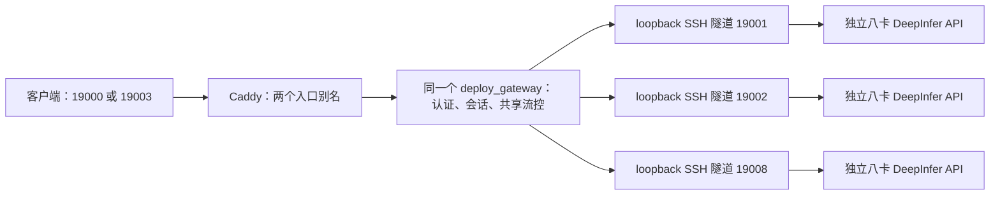

# DeepInfer 多后端服务池

此文分享使用成功的服务结构，不提供私有 supervisor、认证、机器地址或账号，不构成可用性保证。各机器独立运行[单机八卡 API](deepinfer.md)，不是 P/D 拆分，也不是一个跨机器的原生 batch。



## SSH、认证与单个路由进程

每条隧道由使用者自己的 SSH 配置/进程管理器管理；例如把各机器的原生 loopback API 映射到本机 `127.0.0.1:19001`、`19002`、`19008`。转发必须绑定 loopback，目标地址、账号、端口和密钥自行填写，不能照搬别人的 SSH 配置。[tunnel@.service](../../../../services/deepinfer/tunnel@.service) 是 Linux 模板，安装前设置服务用户和对应 SSH alias/LocalForward；Windows 可使用同样的 OpenSSH 命令，由自己的任务计划/进程管理器托管。

按[认证存储格式](../../../gateway.md)在私有目录创建自己的 key-store、绑定和状态文件，认证材料不放 Git，也不打印在命令行。创建私有 admission 文件，使 `enabled_ports` 只包含已验收的隧道端口；空列表或文件无效会关闭新请求准入。代码示例中的端口只表示 loopback 后端，不代表可直接公网访问。

从仓库根目录启动**一个**路由进程：

```sh
python3 -m deploy_gateway --listen 127.0.0.1 --port 19010 \
  --backend-port 19001 --backend-port 19002 --backend-port 19008 \
  --backend-managed-affinity --max-active-per-backend 32 \
  --max-waiting 32 --queue-timeout 5 --model-context-limit 1048576 \
  --key-store local/keyring.json --bindings-file local/bindings.json \
  --backend-state local/backend-state.json --control-file local/admission.json
```

这是显式启动命令，不由生成器执行。Linux 可调整并安装[gateway.service](../../../../services/deepinfer/gateway.service)；先创建私有配置和可写状态目录、核实解释器/用户/路径，再 `daemon-reload` 与启动。启动模板不修改远端模型。Windows 使用同一 Python 入口，不需要本仓私有 supervisor。

## 双入口共享池

复制 [Caddyfile.example](../../../../services/deepinfer/Caddyfile.example) 到自己的私有配置，审阅、`caddy validate` 后再运行 Caddy。模板默认仅 loopback；对外监听、TLS、网络准入由使用者明确配置。两个入口都转发至 `127.0.0.1:19010`，保留 Authorization、SSE 即时刷新及客户端取消语义；不启用记录请求/认证材料的访问日志。

模板使用正值 flush interval；SSE 按类型即时刷新。不要改成 `flush_interval -1`：[Caddy 文档](https://caddyserver.com/docs/caddyfile/directives/reverse_proxy#streaming)说明负值模式在客户端提前断开时不取消后端请求。上线仍需验证完整链路的取消行为。

不能为两个入口分别启动网关，否则配额和会话会分散。客户端发送有效 Bearer key；网关检查 SHA-256 记录，不向原生模型转发认证材料。健康后端按在途与绑定分配请求；会话优先留在同一机器。DeepInfer 自己选择 DP rank 和 prefix cache，网关不注入 vLLM 的专用 rank 头。

每后端上限 32、全池等待上限 32、等待 5 秒仅是 HTTP 准入策略，不保证 96 个请求同时在设备上执行，更不能作为吞吐结果。满载/队列或等待超限返回 429；无健康且准入的后端返回 503。开始返回 SSE 后不能无损搬迁正在生成的 KV。

## 验收与运维

分别验证每个原生 API 的八 worker、预热和实际模型，再验证隧道、网关认证缺失/错误控制、两个入口的有效认证、短请求/SSE、取消、满载和排空。不能仅凭容器 running 或端口 listening 宣称恢复。用自己的客户端验收，不复制用户会话作为公开预热。

新增/换机时先在 `enabled_ports` 排空目标，确认网关在途、原生请求和连接归零，保留旧实例后切换；勿停止其他任务。原生重启由[每分钟采样的一小时空闲恢复](../../../recovery.md)负责，隧道/路由的进程重启不授权重拉模型。通知策略见[通知文档](../../../notifications.md)。原始状态、认证、主机映射与运行收据只保存在自己的私有目录，不提供到仓库或 Pages。
